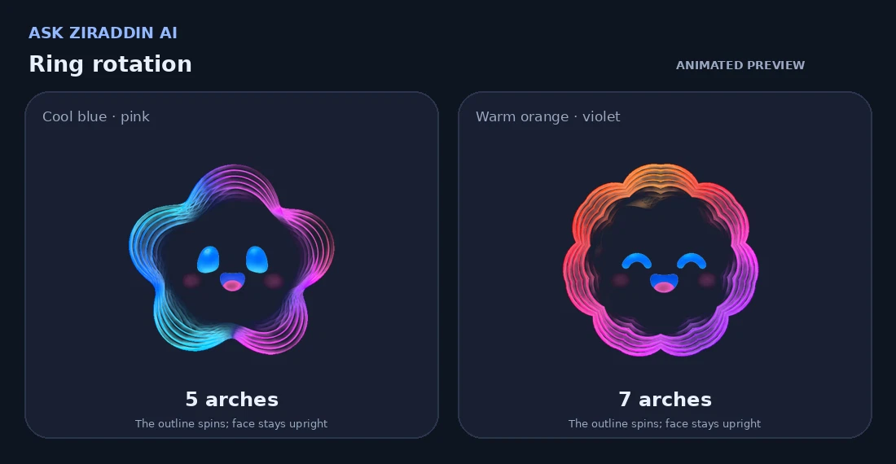
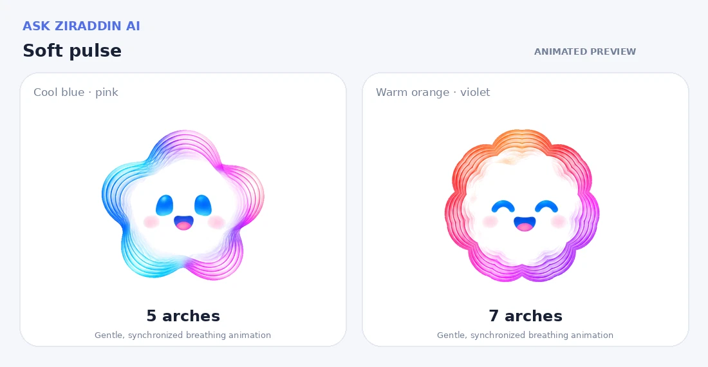
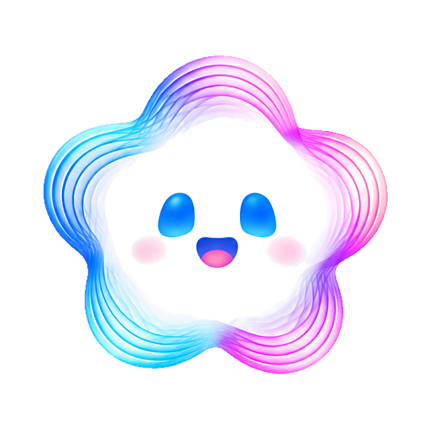
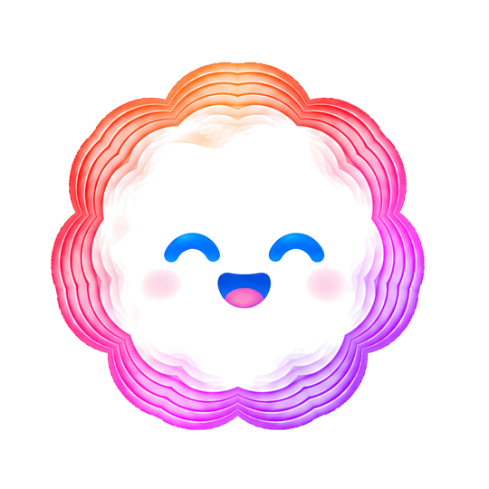

# Ask Ziraddin AI — Animated Mascots

Two transparent, website-ready mascot designs: **5 arches** (blue / pink) and **7 symmetrical arches** (orange / violet). Both retain their expressions while their outlines move.

## Animated previews

**Rotating rings · dark mode** — the colorful outline turns while the face stays upright.

**Soft pulse · light mode** — gentle breathing motion.

> Animated WebP previews play directly in GitHub and modern Markdown viewers. For the **interactive demo**, open **[`index.html`](index.html)** in your browser; it includes all five modes and a dark/light toggle.

## Transparent assets

| 5 arches | 7 arches |
| --- | --- |
|  |  |
| [`five_mascot_transparent.png`](assets/five_mascot_transparent.png) | [`seven_mascot_transparent.png`](assets/seven_mascot_transparent.png) |

Inside `assets/`: the **full transparent PNG**, **ring-only PNG**, and **face-only PNG** for each mascot (540 × 540 RGBA). Use the full PNG for static placement; stack the ring and face PNGs to animate them independently. The face centers remain transparent, allowing your website background to show through.

## Run / reuse

1. Extract this ZIP and double-click **`index.html`**. No packages, server, or internet required.
2. Choose **Gentle float**, **Rotate ring**, **Soft pulse**, **AI thinking**, or **Chat opened**.
3. Copy the PNGs under `assets/` into your own website for integration.

The HTML is the same approved self-contained preview, with its embedded imagery and five motion modes preserved. The README WebP loops are rendered samples rather than interactive controls.
